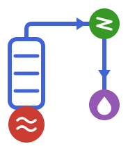

<p align="center">
  
</p>

<h1 align="center">BatchDistillation.jl</h1>

<p align="center">
  Dynamic simulation of batch distillation columns in Julia — a rigorous
  <a href="https://github.com/SciML/ModelingToolkit.jl">ModelingToolkit.jl</a> model with
  <a href="https://github.com/ClapeyronThermo/Clapeyron.jl">Clapeyron.jl</a> thermodynamics.
</p>

---

## Installation

Requires Julia 1.10 or newer. The package is not registered — install it directly
from GitHub:

```julia
using Pkg
Pkg.add(url = "https://github.com/se-schmitt/BatchDistillation.jl")
```

or, from the Pkg REPL mode (`]`):

```
pkg> add https://github.com/se-schmitt/BatchDistillation.jl
```

## Example

A binary methanol/ethanol charge, separated in a column with four equilibrium
stages at a reflux ratio of 4:

```julia
using BatchDistillation
using Clapeyron, ModelingToolkit, OrdinaryDiffEq

# 1 — thermodynamics: any Clapeyron EoS or activity model
fluid    = UNIFAC(["methanol", "ethanol"])

p        = 1.01325e5        # Pa   column pressure
Q        = 400.0            # W    reboiler duty
N_stages = 5                #      1 reboiler + 4 equilibrium stages
x_charge = [0.5, 0.5]       #      initial still composition
n_charge = 20.0             # mol  initial still holdup

# 2 — build the flowsheet and compile the DAE
@named col = Column(; fluid, N_stages, p)
sys = mtkcompile(col)

# 3 — operating parameters
pars = Dict(sys.reb.Q => Q, sys.cond.nB => 0.05, sys.cond.ϵ => 0.2)   # ϵ = D/V ⟹ R = 4

# 4 — consistent initial state from a total-reflux steady state
init = initialize_total_reflux(sys; fluid, N_stages, p, Q, x_charge, n_charge)

# 5 — solve one hour of batch operation
prob = ODEProblem(sys, merge(Dict(init.u0), pars), (0.0, 3600.0); guesses = init.guesses)
sol  = solve(prob, FBDF(autodiff = AutoFiniteDiff()); reltol = 1e-6, abstol = 1e-8)

# 6 — results
sol[sys.res.nL][end]      # 7.57 mol of distillate collected
sol[sys.res.x[1]][end]    # 0.825  methanol in the collected product
sol[sys.reb.x[1]][end]    # 0.333  methanol left in the still
```

The column pressure is a single `Column` keyword — it becomes the default of the
`p` parameter of every unit, and can still be overridden per unit (`sys.cond.p => …`)
if you ever want a pressure profile.

The thermodynamic calls are registered as symbolic functions with hand-supplied
derivatives, so the integrator has to build its Jacobian by finite differences
(`autodiff = AutoFiniteDiff()`) rather than by differentiating through Clapeyron.

A larger, runnable example — a three-component batch (butan-1-ol / propan-2-ol /
water) in a 12-unit packed column with wall heat capacities, a heat loss at the
head and a pressure profile — is in
[`examples/batch_distillation_3comp/`](examples/batch_distillation_3comp/).

## Physical basics

The column is a stack of well-mixed units — a heated **reboiler** (still) at the
bottom, `N_stages - 1` equilibrium **stages** above it, a total **condenser** with
reflux drum on top, and a **reservoir** that collects the distillate:

```
                         res               distillate receiver
                          ▲
                          │  D = ϵ·V
                 ┌────────┴────┐
                 │    cond     │           total condenser + reflux drum
                 └──┬───────▲──┘
          reflux    │       │  vapour
       (1−ϵ)·V      ▼       │
                 ┌──┴───────┴──┐
                 │   stage_N   │
                 │      ⋮      │           equilibrium stages (stage_2 … stage_N)
                 │   stage_2   │
                 └──┬───────▲──┘
                    ▼       │  boil-up
                 ┌──┴───────┴──┐
        Q  ─────►│     reb     │           heated still / reboiler
                 └─────────────┘
```

Every unit carries the transient **MESH** equations plus a hydraulic closure,
written in the liquid holdup `nL`, the liquid composition `x` and the internal
energy `U`:

| | |
|---|---|
| total balance | `d(nL)/dt = L_in + V_in − L_out − V_out` |
| component balance | `d(x_i)/dt = [ L_in·(z_in,i − x_i) + V_in·(y_in,i − x_i) − V_out·(y_i − x_i) ] / nL` |
| energy balance | `d(U)/dt = Σ (ṅ·h)_in − Σ (ṅ·h)_out + Q − Q_wall` |
| equilibrium | `T, y = bubble point of x at p` |
| summation | `Σ x_i = 1` |
| energy holdup | `U = nL · h_liq(p, T, x)` |
| hydraulics | `nL = (n_ref / B_ref) · h · L_out` |

The liquid leaving a unit does so at the unit's own composition, which is why the
`L_out` term drops out of the component balance. The equilibrium relation is what
closes the system: every unit sits at its bubble point, so its temperature `T` and
the vapour composition `y` in equilibrium with `x` follow from an isobaric
bubble-point calculation. That calculation and the molar enthalpies both come from
Clapeyron.jl, so the same column runs with cubic equations of state, SAFT models or
activity-coefficient models — `fluid` is simply any Clapeyron `EoSModel`.

A few more ingredients make the model behave like a real apparatus:

* **Hydraulics.** The holdup correlation scales a reference holdup `n_ref`, measured
  at a reference boil-up `B_ref` over a section of height `h`, with the actual
  liquid load. It is what sets the residence time of a stage, and hence the speed
  at which a composition front travels up the column.
* **Reflux split.** The condenser splits the condensate with the distillate
  fraction `ϵ = D/V`, so the reflux ratio is `R = (1 − ϵ)/ϵ`. The drum holdup `nB`
  smooths the product composition. With `use_ΔT = true` the reflux is subcooled by
  a fixed `ΔT` instead of being at its bubble point.
* **Thermal inertia and losses.** `stage_f_U`/`reb_f_U` add the energy stored in
  the column internals, `stage_UA`/`reb_UA` couple it through a wall temperature
  (`dU_wall/dt = UA·(T − T_wall)`), and `stage_F_Q` applies a heat loss to the
  surroundings.

Because the composition, energy and equilibrium equations are coupled, the result
is a stiff, high-index DAE. ModelingToolkit performs the index reduction in
`mtkcompile`, and `initialize_total_reflux` supplies a physically consistent
starting point by solving the total-reflux steady state (`x_i = y_{i−1}` up the
column, with the still pinned to the charge) before the batch is started. It
returns every differential state in `u0` and exactly the algebraic ones in
`guesses`, so the initialization system is square; pass `fully_determined = true`
to `ODEProblem` if you want ModelingToolkit to verify that.

## API

| | |
|---|---|
| `Column(; fluid, N_stages, …)` | assemble reboiler, stages, condenser and reservoir into one `ODESystem` |
| `initialize_total_reflux(sys; fluid, N_stages, p, Q, x_charge, …)` | consistent initial state `(; u0, guesses, V, …)` from a total-reflux steady state |

`Column` keywords: `p` (column pressure, default 1 atm), `add_reservoir`, `use_ΔT`,
`stage_h`, `reb_f_U`, `stage_f_U`, `stage_F_Q`, `reb_UA`, `stage_UA`.
