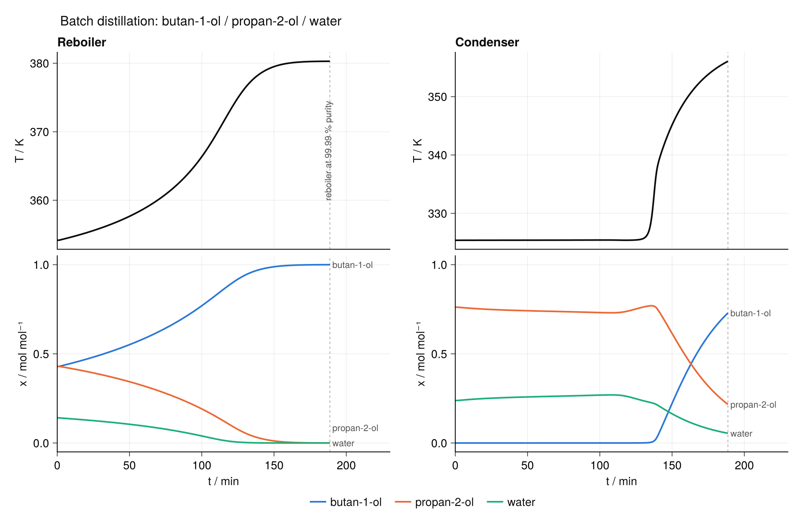

# Three-component batch distillation

A packed batch column separating **butan-1-ol / propan-2-ol / water**, with the
thermal inertia of the column internals resolved: every unit carries a wall
temperature (`UA`, `f_U`), the top stage loses 2 W to the surroundings, and the
pressure drops linearly from the reboiler to the head.

| | |
|---|---|
| column | 12 units (reboiler + 11 stages), 1.5 m packed height |
| charge | 21.1 mol at x = (0.429, 0.430, 0.141) |
| duty | 230.71 W |
| pressure | 70.0 kPa at the head, 93 Pa total drop |
| efflux ratio | ϵ = 0.30 (reflux ratio R = 2.33) |
| condenser | reflux drum nB = 3.3 mol, reflux subcooled by ΔT = 20 K |
| thermodynamics | UNIFAC (group contributions from GCIdentifier) with SRK pure models |

## Running it

Set the environment up once, from the repo root:

```julia
using Pkg
Pkg.activate("examples/batch_distillation_3comp")
Pkg.develop(path = ".")        # BatchDistillation is not registered
Pkg.instantiate()
```

then run it from the shell:

```
julia --project=examples/batch_distillation_3comp \
      examples/batch_distillation_3comp/run_batch_distillation.jl
```

It writes `T_x_reboiler_condenser.png` and `profiles.csv` next to the script.
Expect a few minutes: `mtkcompile` has to index-reduce a 12-unit DAE, and the
integrator builds its Jacobian by finite differences over Clapeyron bubble-point
calls.

## Result



The reboiler climbs from 354 K to 380 K as the light components are stripped and it
concentrates to nearly pure butan-1-ol. The overhead sits at ~325 K with
x(propan-2-ol) ≈ 0.76 until the propan-2-ol in the still is exhausted at ~135 min,
then breaks through to 357 K as butan-1-ol carries over. The batch is stopped at
189 min, when the still reaches 99.99 % butan-1-ol with 4.48 mol left in it.

## Stopping criteria

The batch ends on whichever comes first:

| | |
|---|---|
| dry-out | reboiler holdup below `n_dry = 0.5` mol |
| purity | any reboiler mole fraction above `1 - x_pure`, with `x_pure = 1e-4` |

Here the purity criterion is the one that fires, at t = 11 318 s (189 min), and it
is not cosmetic. Left to run, the still composition leaves the simplex once it is
essentially pure: by t ≈ 12 374 s x(butan-1-ol) = 1.0000008 and x(water) = −2.7e-6,
which makes the Jacobian non-finite in the reboiler and stage-2 rows, and the solve
gives up with `ReturnCode.Unstable` and 2.81 mol still in the reboiler. With
`abstol = 1e-6` the trace components, by then running at ~1e-6, sit below the
tolerance that would have to hold them non-negative. Stopping at 99.99 % ends the
batch while the state is still physical.

For reference, the reboiler crosses `1 - x_pure` at roughly:

| `x_pure` | 1e-2 | 1e-3 | 1e-4 | 1e-5 | 1e-6 |
|---|---|---|---|---|---|
| t / min | 152 | 173 | **188** | 200 | never reached |

Dry-out never governs this experiment: 4.48 mol are still in the reboiler when the
purity criterion fires, and at D = ϵ·V ≈ 1.6 mmol s⁻¹ it would take another ~40 min
to reach 0.5 mol — long past the point where the solve fails.
